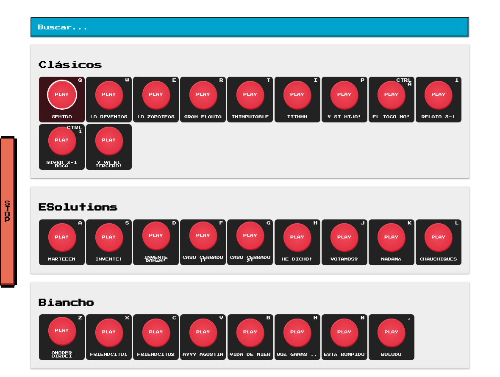

# Hotkey Soundboard

A keyboard-driven soundboard that runs in the browser. Press a key, hear a clip. Built with Angular.

**Live demo:** https://fpradomacat.github.io/hotkey-soundboard/



The clips are short Spanish-language (Argentine) catchphrases and football commentary, grouped by keyboard row. The UI is in Spanish.

## Features

- **One key per clip.** Each card shows its hotkey. Some use `Ctrl` as a modifier.
- **Stop with Shift.** A single shared player: a new clip always cuts the previous one. `Shift` (or the STOP button) silences it.
- **Instant search.** Case- and accent-insensitive: `roman` finds "Invente Román!".
- **Shows what is playing.** The active card is highlighted and announced to screen readers.
- **Accessible.** Real `<button>` elements, visible keyboard focus, `aria-keyshortcuts`, labelled search box.
- **Safe with browser shortcuts.** Key repeat, Caps Lock and Alt/Meta combinations are handled; `Ctrl+A` plays its clip without selecting the page.

## Keyboard shortcuts

| Key | Action |
| --- | --- |
| Letter / digit shown on a card | Play that clip |
| `Shift` | Stop the current clip |
| Typing in the search box | Disables clip hotkeys until the box is empty |

## Tech stack

- Angular 22: standalone components, signals, zoneless change detection, `@if` / `@for` control flow
- TypeScript (strict), SCSS, esbuild builder
- Karma + Jasmine unit tests, ESLint with `angular-eslint` (including template accessibility rules)
- GitHub Actions: checks on pull requests, deploy to GitHub Pages
- No backend. The font (Press Start 2P, SIL OFL) is self-hosted, so the app makes no third-party requests.

## Getting started

You need Node.js 22.22.3 or newer (or 24.15+), and Chrome for the tests.

```bash
npm ci
npm start          # http://localhost:4200
```

| Command | What it does |
| --- | --- |
| `npm start` | Dev server with live reload |
| `npm run build` | Production build into `dist/` |
| `npm test` | Unit tests in watch mode |
| `npm run test:ci` | Unit tests once, headless |
| `npm run lint` | ESLint, including accessibility checks for templates |
| `npm run validate:sounds` | Checks `sounds.json` against the audio files |

## Adding a clip

1. Put the file in `src/assets/audio/`, for example `my_clip.mp3`.
2. Add an entry to a section in `src/app/sounds.json`:

   ```json
   { "file": "my_clip", "name": "My clip", "hotkey": "x" }
   ```

   Use `"ctrl": true` if the hotkey needs Ctrl. Leave out `hotkey` for a clip without one.
3. Run `npm run validate:sounds`. It fails on a missing file, an unused file, or a repeated hotkey.

## Project structure

```
src/app/
  sounds.json                  all clips: sections, names, hotkeys
  sounds-database.ts           turns sounds.json into Section / Sound objects
  sounds-library.service.ts    hotkey lookup and search
  sound-player.service.ts      the shared audio element, exposes the current sound as a signal
  dashboard/                   page: search, global keyboard handler
  sounds-section/ sound-card/ stop-button/
scripts/validate-sounds.mjs    data check, also run in CI
.github/workflows/             ci.yml (pull requests) and deploy.yml (GitHub Pages)
```

## Deployment

Every push to `master` builds the app and publishes it with GitHub Pages. In the repository settings, Pages must use **GitHub Actions** as its source. The workflow reads the repository name for the `--base-href`, so the project can be renamed without changing it.

## Audio

The MIT license covers the source code only. The audio clips are recordings of people and broadcast commentary that are not covered by it and may belong to their respective owners.

## License

[MIT](LICENSE), for the code.
